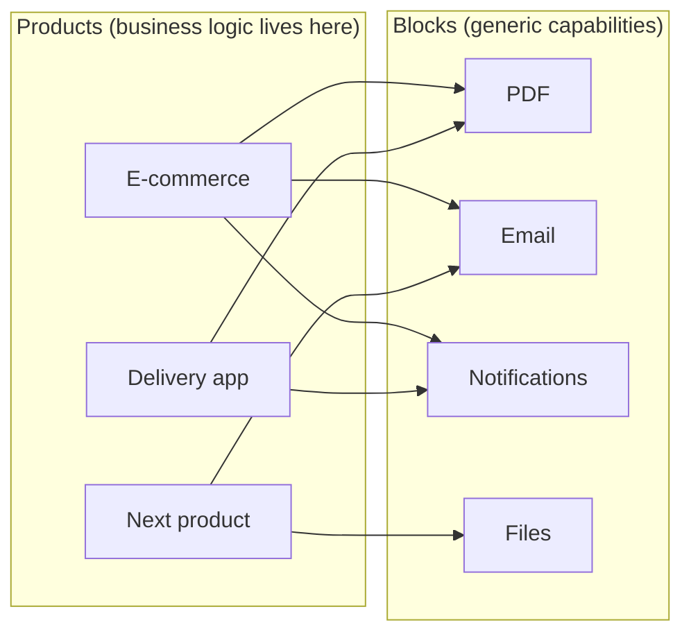

# 1. Business

## The problem

Every product I build needs the same handful of capabilities: generate an invoice PDF, send an
email, push a notification, store an uploaded file. Built inside each product, they get written
again each time, slightly differently, and a fix in one never reaches the others.

Third-party services solve this for other people, but they cost money per call, they do not run on
my own infrastructure, and some (Arabic PDF rendering, local SMS gateways) do not exist in the
shape I need.

## The idea

Build each capability **once**, as a block that runs on its own, and plug it into any product
through the same few conventions. A new product should get PDFs, email and notifications by adding
a package and a key, not by writing code.

A product decides *what* happens ("an order was placed, so render the invoice, then email it").
A block only knows *how* to do its one thing ("render this template with this data").

The same blocks are also what I install for a company that asks for, say, an invoice printing
service: the released images go onto their server, their systems become the clients, the invoice
design is authored as a template, and their workflow is configured rather than coded. **No code is
written or changed per company.** How is in [06-deployment.md](06-deployment.md).

## Who uses it

| Who | What they need | How they touch the system |
| --- | --- | --- |
| **Operator** (me; or a company's IT on their deployment) | Create keys for products, author templates, see failed jobs, rotate secrets. | The block's console (web UI). |
| **Product developer** (me; or a company's developers) | Add a block to a product in minutes, with typed code and no surprises. | The block's client package or plain HTTP from the OpenAPI document, with an API key. |
| **Company IT** (dedicated deployments) | Install, upgrade and back up without knowing the code. | The deployment kit and its README. |
| **Product end user** (a shopper, a driver) | Gets the PDF, email or notification. Never knows a block exists. | Indirectly, through the product. |

There is no self-service sign-up: every deployment has one operator role, signed in with that
deployment's admin key, and a sign-up flow would be built for nobody.

## What a block must guarantee

These are the promises a product relies on. They are business requirements, not technical
preferences: break one and a product breaks.

1. **Isolation between clients.** One product never sees, lists or downloads another product's
   templates, jobs or files.
2. **Retries are safe.** A product that retries a request after a timeout does not get two PDFs,
   two emails or two charges.
3. **Slow work never blocks the product.** Anything taking more than a second is accepted
   immediately and reported later, by polling, webhook or message.
4. **Failures say what to do.** Every failure carries a stable code that tells the product whether
   retrying could help.
5. **Files are private by default.** A link to a generated file stops working after a set time.
6. **One noisy product cannot starve the others.** Each client has its own rate and concurrency
   limits.

## The block catalogue

| Block | Does | Status | Priority |
| --- | --- | --- | --- |
| **PDF** | HTML template + JSON → PDF, with template authoring. | Running; becomes multi-client in phase 1. | Now |
| **Email** | Templated transactional email through a provider (SMTP, Resend, SES), with attachments by URL. | Not started. | Next |
| **Notifications** | Push (FCM), SMS and in-app messages to a recipient id the product supplies. | Not started. | Later |
| **Files** | Upload, store and serve files with signed URLs; image resizing. | Not started. | Later |
| **Payments** | One API over local gateways (Paymob, Fawry) with webhooks normalised. | Idea. | Later |
| **Identity** | Sign-up and login for a *product's* end users. | Use Keycloak rather than build one. | When a product needs it |

### What is never a block

Orders, carts, catalogues, menus, deliveries, customers. They look reusable but differ in every
product, and a generic version ends up too complicated for each of them. If a candidate block needs
a business noun in its API, it belongs in a product.

## Logging in, and to what

Two kinds of login get confused, so the difference is written down:

| | Who logs in | Where it lives | Phase |
| --- | --- | --- | --- |
| **Console access** | The operator, into a block's console. | Each block, using an admin key exchanged for a session. | 1 |
| **Product → block** | A product's backend, calling a block. | API keys. No login, no user. | 1 |
| **End-user login** | A shopper, into a product. | The product, or an Identity block (Keycloak). Never PDF, Email or the others. | When a product needs it |

## Deployment modes

| | Shared | Dedicated |
| --- | --- | --- |
| Runs on | My VM | A company's server |
| Clients are | My products | The company's systems |
| Data leaves the company | n/a | Never |
| Branding | Block's own | The company's name and logo, from configuration |

Both run the same released images. Dedicated deployment is not a later phase: it is a requirement
of phase 1, because the first company that asks should get the same code my products use.

## Phases

### Phase 1: blocks for my products, installable anywhere (now)

- PDF Builder becomes multi-client: API keys, client-scoped templates and jobs, persistent storage.
- Each block has its own console; the operator signs in with an admin key.
- Every block ships as versioned images plus a deployment kit, with branding, templates and fonts
  supplied as configuration and data.
- The shared studs are extracted so the second block starts from them.
- **Done when:** the e-commerce product generates and emails invoices using two blocks, a third
  product could add the PDF block in under an hour, and the PDF block can be installed on a clean
  Linux server from the kit alone.

### Phase 2: one console for all blocks (when there are three or more blocks)

- A console shell that hosts every block's screens, so the operator stops switching between apps.
- Keys issued centrally instead of per block (an auth server issuing tokens that every block
  verifies). Blocks keep working unchanged because they only read claims.
- **Trigger:** managing the same client in three consoles is a weekly chore.

### Phase 3: a hosted service for other people (only if decided)

Distinct from dedicated deployments: here many companies would share *my* deployment.

- Organisations, users, sign-up and billing; "client" gains an owning tenant.
- Usage metering and plans.
- **Not designed here.** Phases 1 and 2 avoid choices that would block it, nothing more.

## Success measures

| Measure | Target |
| --- | --- |
| Time for a new product to make its first successful call to a block | Under 1 hour, using only the block's README and client package |
| Code a product writes to use a block | Registration plus calls; no HTTP, retry or polling code |
| Cross-client data leaks | Zero, proven by an automated test per block |
| A block's dependency on other blocks at start-up | None |
| Time to install a block at a new company | Half a day, from the kit, with no code changes |
| Customer-specific code in any block repository | None, ever |

## Risks

| Risk | Mitigation |
| --- | --- |
| Building the platform instead of the products. | Phase 1 ends when the first product works. Phase 2 has a trigger, not a date. |
| Blocks drift apart in conventions. | The studs live in one shared package; the constitution makes them non-negotiable. |
| One free VM hosts everything and runs out of memory (Chromium is heavy). | Per-block memory limits in compose; PDF render concurrency is configured, not unbounded. |
| A leaked API key. | Keys are per client and per block, revocable from the console, and shown only once. |
| A company asks for "just one small change" and a fork begins. | The decision flow in [06-deployment.md](06-deployment.md#when-a-customer-asks-for-something): configure, generalise behind a flag, or push it to orchestration. |
| Dedicated deployments fall behind on versions and need old fixes. | Two supported minor versions; upgrades are one script; contracts change additively. |
