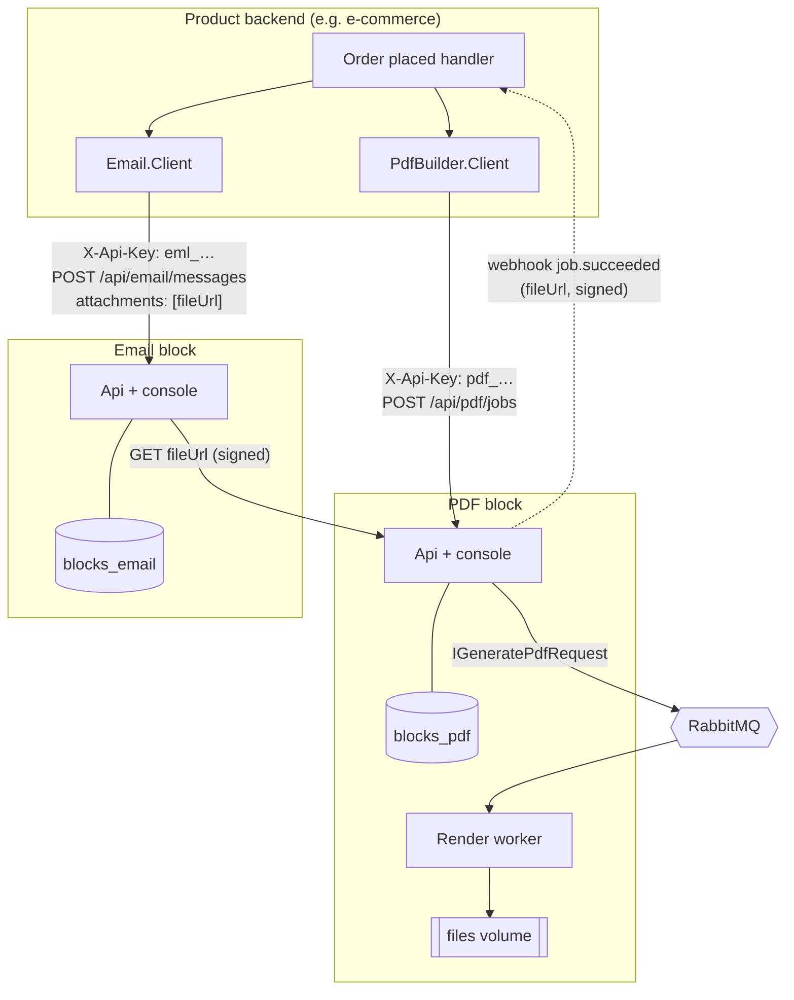
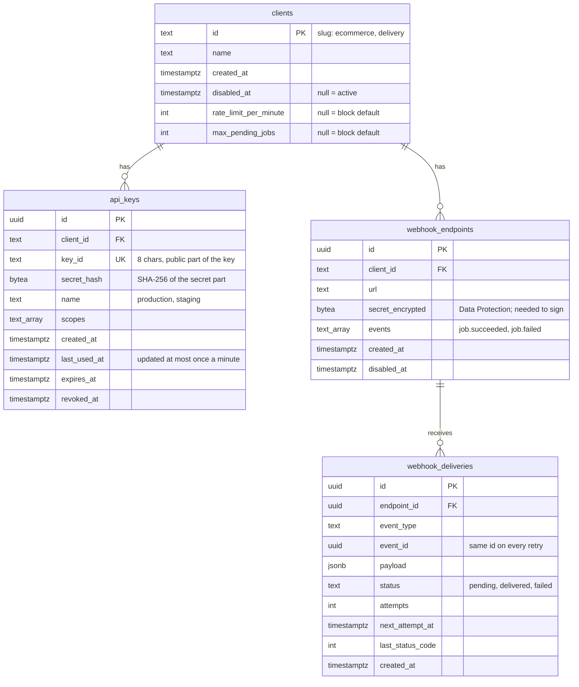
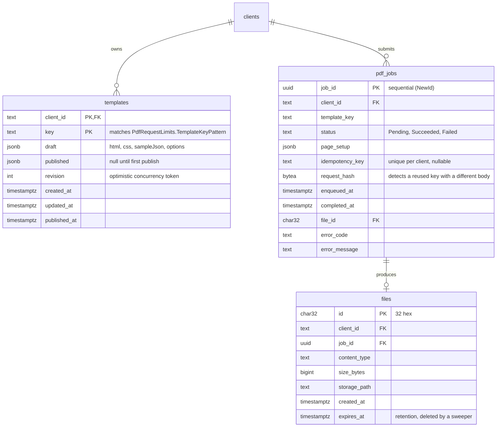

# 3. Planning

## Architecture

### How a product uses blocks



What the diagram shows:

- The product orchestrates. PDF never calls Email. The email block fetches the attachment through a
  signed URL, which is a convention both follow, not a dependency between them.
- Each block has its own database. They may sit on the same Postgres server, but each block
  connects as its own role that can see only its own database.
- A product talks to a block over HTTP with a key, or over RabbitMQ with the block's contracts
  package. Both carry the client's identity.

### Runtime topology (phase 1, one VM)

```
Oracle Ampere VM (arm64, 2 OCPU / 12 GB)
├── caddy                 TLS, routes by host: pdf.example.com, email.example.com, shop.example.com
├── postgres              one server; databases blocks_pdf, blocks_email, shop; one role per database
├── rabbitmq              shared broker; one vhost per block
├── pdf-api   (+ web)     mem_limit 3g (Chromium)
├── email-api (+ web)     mem_limit 512m
└── shop                  the product
```

Shared infrastructure (Postgres server, RabbitMQ, Caddy) is not a block and not glue: any block can
point at a different server through configuration alone. The isolation that matters is the database
and the vhost, and those are per block.

### Inside a block

Unchanged from [../architecture.md](../architecture.md): `Api -> Infrastructure -> Application ->
Domain -> Contracts`. Phase 1 adds one shared library underneath the API:

```
PdfBuilder.Api ──────────────► Blocks.ServiceDefaults   (studs: auth, problems, idempotency,
     │                              │                    webhooks, health, OpenTelemetry)
     ▼                              ▼
PdfBuilder.Infrastructure      Blocks.ServiceDefaults.EntityFramework
     │                              (clients, api_keys, webhook_* tables, outbox)
     ▼
PdfBuilder.Application -> PdfBuilder.Domain -> PdfBuilder.Contracts
```

Features in `Application` receive the caller as an `ICurrentClient` with `ClientId` and `Scopes`.
They never see headers, keys or cookies.

## Data model

Postgres, EF Core with `Npgsql`, snake_case names (`EFCore.NamingConventions`). Every table that
holds client data has `client_id` and a global query filter on it.

### Stud tables (every block has these, from `Blocks.ServiceDefaults.EntityFramework`)



Also present, owned by libraries rather than by us: `data_protection_keys` (so console sessions and
encrypted webhook secrets survive restarts) and MassTransit's outbox tables (`inbox_state`,
`outbox_message`, `outbox_state`).

Webhook secrets are encrypted, not hashed, because the block has to use them to sign each delivery.
API key secrets are hashed, because the block only ever has to check them.

### PDF block tables



Indexes: `pdf_jobs (client_id, enqueued_at desc)` for the jobs list; unique
`pdf_jobs (client_id, idempotency_key) where idempotency_key is not null`; `files (expires_at)` for
the sweeper.

Built-in templates (`templates/` in the repository) stay on disk and are shared by every client.
An authored template may not use a built-in key, as today (`TEMPLATE_KEY_TAKEN`).

The domain records (`AuthoredTemplate`, `PdfJob`) keep their private constructors. Infrastructure
maps them to EF entity classes, as [../operations.md](../operations.md#scaling-past-one-instance)
already recommends.

## Repository structure

### Phase 1: everything starts here

```
pdf-builder/
├── src/
│   ├── Blocks.ServiceDefaults/                  NEW  studs: auth, problems, idempotency, webhooks, health
│   ├── Blocks.ServiceDefaults.EntityFramework/  NEW  stud tables, ICurrentClient query filter, outbox
│   ├── Blocks.Client/                           NEW  shared client plumbing: key header, errors, webhook verify
│   ├── PdfBuilder.Contracts/                         + ClientId on IGeneratePdfRequest
│   ├── PdfBuilder.Client/                       NEW  typed HTTP client + DI registration for products
│   ├── PdfBuilder.Domain/
│   ├── PdfBuilder.Application/
│   ├── PdfBuilder.Infrastructure/                    + Persistence/ (DbContext, migrations, stores)
│   └── PdfBuilder.Api/                               + console session, admin endpoints
├── tools/
│   └── Blocks.Cli/                              NEW  keygen, admin-key hash, client bootstrap
├── web/                                              + sign in, clients, keys, webhooks, server jobs list
└── docs/blocks/                                      these documents
```

### When the second block starts: extract the platform

```
blocks-platform/                 shared, versioned, published
├── src/Blocks.ServiceDefaults/                  → NuGet  (GitHub Packages)
├── src/Blocks.ServiceDefaults.EntityFramework/  → NuGet
├── src/Blocks.Client/                           → NuGet
├── tools/Blocks.Cli/                            → dotnet tool
├── web/blocks-ui/                               → the shared UI folder, copied into consoles (see 05)
└── docs/                                        these documents, moved here

pdf-builder/       references Blocks.* packages
email-block/       same layout as pdf-builder, created from it
shop/              the product: references PdfBuilder.Client, Email.Client
```

Moving out is mechanical because nothing in `Blocks.*` references `PdfBuilder.*`. A test enforces
that (see [04-backend.md](04-backend.md#testing)).

### How a product adds a block

```csharp
// shop/Program.cs
builder.Services.AddPdfBuilderClient(builder.Configuration.GetSection("Blocks:Pdf"));
//   "Blocks:Pdf": { "BaseUrl": "https://pdf.example.com", "ApiKey": "pdf_k7f2a9c1_…" }

// anywhere in the product
var job = await pdf.GenerateAsync("invoice", order.ToInvoiceData(), idempotencyKey: $"invoice-{order.Id}", ct);
// job.FileUrl is a signed URL; hand it to the email block as an attachment.
```

## Feature backlog

Each entry is one spec-kit feature. The description is written to paste into `/speckit.specify`:
it says what and why, and leaves how to `/speckit.plan`, which should be given the matching section
of the backend or frontend document.

| # | Feature | Depends on | Plan context |
| --- | --- | --- | --- |
| 001 | Persistent storage | – | [04 Persistence](04-backend.md#persistence) |
| 002 | Clients and API keys | 001 | [04 Auth](04-backend.md#authentication) |
| 003 | Client-scoped templates and jobs | 002 | [04 Client scoping](04-backend.md#client-scoping) |
| 004 | Console sign-in and key management | 002 | [05 Auth](05-frontend.md#authentication), [05 New features](05-frontend.md#new-features) |
| 005 | Private, expiring files | 003 | [04 Files](04-backend.md#files) |
| 006 | Idempotent job submission | 003 | [04 Idempotency](04-backend.md#idempotency) |
| 007 | Webhooks | 003 | [04 Webhooks](04-backend.md#webhooks) |
| 008 | Per-client limits | 003 | [04 Rate limiting](04-backend.md#rate-limiting) |
| 009 | Product client package | 005, 006 | [04 Client package](04-backend.md#client-package) |
| 010 | Server-side jobs list in the console | 003, 004 | [05 New features](05-frontend.md#new-features) |
| 011 | Extract the platform | all above | [03 Repository structure](#repository-structure) |
| 012 | Runtime branding | 004 | [05 Runtime branding](05-frontend.md#runtime-branding), [06 Configures](06-deployment.md#what-a-deployment-configures) |
| 013 | Template packs and fonts | 003 | [04 Template packs](04-backend.md#template-packs-and-fonts), [06 Data](06-deployment.md#what-a-deployment-brings-as-data) |
| 014 | Deployment kit and versioned releases | 001, 002 | [06 Release](06-deployment.md#what-a-release-is), [06 Kit](06-deployment.md#the-deployment-kit) |

### 001: Persistent storage

> Jobs and authored templates must survive a restart and be visible from any instance of the
> service. Today jobs live in memory for 24 hours and templates are files on one machine, so a
> restart loses job history and a second instance cannot be run. Move both to a database without
> changing any API response, message contract or console behaviour. Existing authored templates on
> disk must be imported once, automatically, on first start.

### 002: Clients and API keys

> Every call to the PDF block's API must identify which client (product) is making it. The operator
> registers clients and issues API keys for them; a product sends its key with each request. Keys
> can be named, scoped, expired and revoked, and a revoked key stops working within a minute. A key
> is shown only once, when created, and the service never stores it in a form that could be read
> back. The operator has one admin key, set in configuration, that can manage clients and keys.
> Health endpoints stay open. Requests without a valid key are refused with a clear, uniform error.

### 003: Client-scoped templates and jobs

> Templates, jobs and files belong to the client that created them. A client can list, read, use
> and change only its own; another client's template key behaves as if it does not exist, even if
> the same key exists elsewhere. Built-in templates remain available to every client. Messages
> arriving on the bus carry the client too; messages from older publishers that do not carry one
> are treated as coming from a configured default client so they keep working.

### 004: Console sign-in and key management

> The console must no longer be open to anyone who can reach it. The operator signs in with the
> admin key and stays signed in for a working day. Once signed in, the operator chooses which
> client they are working on, always sees which one it is, and can manage that client's API keys:
> create (showing the key once, with a copy button), see when each was last used, and revoke with
> confirmation. Existing job and template screens work within the chosen client.

### 005: Private, expiring files

> A link to a generated PDF must only work for a limited time and must not be guessable or usable
> to fetch another client's files. Products receive a link that works without extra credentials
> until it expires, and can ask for a fresh link for a job they own. Files are deleted after a
> retention period the operator configures.

### 006: Idempotent job submission

> A product that resends the same job request (after a timeout, a crash or a retry) must not cause a
> second PDF to be rendered. Sending the same idempotency key with the same body returns the
> original job; the same key with a different body is refused as a conflict.

### 007: Webhooks

> Products should learn that a job finished without polling. A client registers one or more HTTPS
> endpoints and chooses which events it wants. Each delivery is signed so the product can verify it
> came from the block, is retried with back-off when the endpoint fails, and can be redelivered by
> the operator from the console.

### 008: Per-client limits

> One client must not be able to slow every other client down. Each client has a request rate limit
> and a cap on how many of its jobs can be waiting at once, with block-wide defaults the operator can
> override per client. A client over its limit is told so, with when to retry.

### 009: Product client package

> A product developer adds the PDF block with a configuration section and one registration line,
> and gets typed methods to generate a PDF and wait for it, with retries, idempotency and polling
> handled. Webhook signature verification is included for products that use webhooks.

### 010: Server-side jobs list in the console

> The jobs page must show every job the block has for the selected client (or all clients),
> filterable by status, template and date, rather than only jobs submitted from this browser.

### 011: Extract the platform

> Everything every block needs (authentication, error format, idempotency, webhooks, health,
> client tables, console building blocks) is moved out of the PDF block into shared packages, so the
> next block starts from them. The PDF block's behaviour does not change.

### 012: Runtime branding

> A company that has the block installed on its own servers sees its own product name and logo in
> the console, set in that deployment's configuration. The same released console is used by every
> deployment; nothing is rebuilt to change branding. The console's colours do not change, and the
> sign-in page always shows which version is running.

### 013: Template packs and fonts

> An operator can export chosen templates from one deployment as a single file and import it into
> another, so an invoice designed and tested in one place can be installed at a company without
> retyping it. Import shows what will be created or replaced and never replaces silently. A
> deployment can also add its own fonts, such as a company's brand font, without a new release.

### 014: Deployment kit and versioned releases

> Installing a block on a company's Linux server needs only a released kit: no source code, no
> build, and no internet access at runtime. The company's IT can install, upgrade to a newer
> version, back up and restore by following the kit's own instructions, and every installation
> runs an exact, known version. Secrets are generated during installation and the admin key is
> shown once.

## Milestones

| Milestone | Features | Outcome |
| --- | --- | --- |
| **M1: Safe to expose** | 001, 002, 003, 004 | Nothing is open; each client sees only its own data. |
| **M2: Installable at a company** | 005, 012, 013, 014 | The PDF block runs on a clean server, branded, from the kit alone. |
| **M3: Pleasant to integrate** | 006, 007, 009 | A product integrates in under an hour with no polling or retry code. |
| **M4: Ready for a second block** | 008, 010, 011 | Email block can start from `blocks-platform`. |

M2 comes before M3 on purpose: a company asking for an invoice service needs installability and
private files, and can integrate over plain HTTP before the client package exists.

## Definition of done (every feature)

- Behaviour covered by tests at the layer where the rule lives, plus one API test for each new
  endpoint's happy path and its main refusal.
- A cross-client test for anything that reads client data: client B gets a 404, not a 403.
- `docs/` updated in the same pull request: these documents for design changes, the existing
  `configuration.md`, `message-contracts.md` and `operations.md` for anything they describe.
- `CHANGELOG.md` entry; `PdfBuilder.Contracts` version bumped if a contract changed.
- `docker compose up --build` still works from a clean checkout; arm64 image still builds in CI.
- No new hardcoded deployment value: anything a company might want different is a configuration
  key with a default, documented in [04-backend.md](04-backend.md#configuration).
