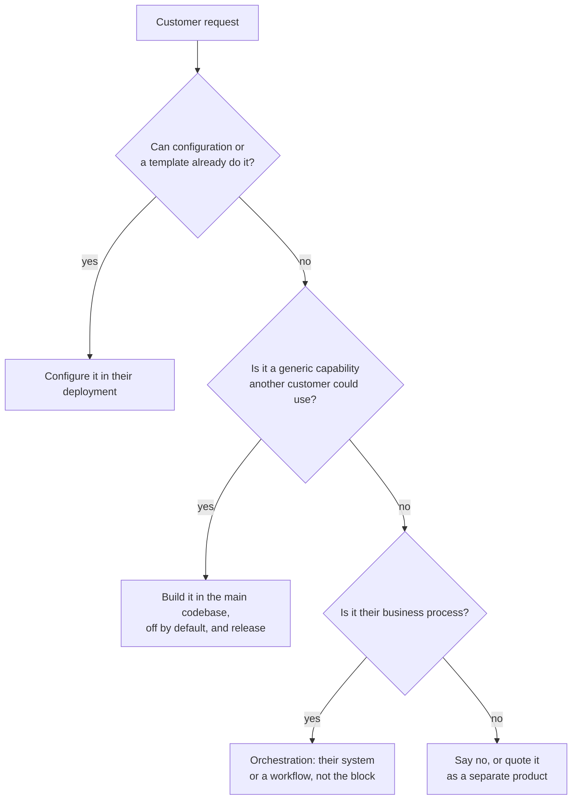

# 6. Deployment

A block is written once and installed many times. The same image runs on my VM for my own products
and on a company's server for theirs. This document is about the second case, because it is where
the temptation to change code for one customer is strongest.

## The rule

**One codebase. No customer forks. Everything a deployment varies is configuration or data.**

| | Same everywhere | Different per deployment |
| --- | --- | --- |
| **Code** | Versioned images (`pdf-builder:1.4.0`) | Never |
| **Configuration** | Defaults in the image | Domain, secrets, database, broker, limits, branding |
| **Data** | Built-in templates | Authored templates, fonts, clients, keys, webhooks, workflows |
| **Infrastructure** | Requirements below | The server, its database, its backups |

A copy of the source changed for one company stops receiving fixes the day it is made. Every later
request from that company then costs a merge, and every security fix costs one per customer.

### When a customer asks for something



"Generic" is tested the same way as for blocks themselves (see
[01-business.md](01-business.md#what-is-never-a-block)): if it needs one of the customer's business
nouns, it does not go in the block.

## Deployment modes

| | **Shared** | **Dedicated** |
| --- | --- | --- |
| Where | My VM | The company's server or cloud account |
| Clients | My products | The company's own systems (ERP, website, mobile backend) |
| Operator | Me | Me, or the company's IT after handover |
| Data leaves the company | n/a | Never |
| Branding | Block's own | The company's name and logo |
| Upgrades | When I deploy | When the company agrees to |

Multi-client support is not wasted in dedicated mode: a company with an ERP and a website has two
clients, each with its own keys, templates and limits.

## What a release is

A release is a set of artefacts with one version number, produced by CI from a tag:

| Artefact | Where | Notes |
| --- | --- | --- |
| API image | `ghcr.io/<owner>/pdf-builder:1.4.0` | `linux/amd64` and `linux/arm64`, digest recorded in the release notes |
| Console image | `ghcr.io/<owner>/pdf-builder-web:1.4.0` | Same versions as the API, always deployed together |
| Deployment kit | Release asset `pdf-builder-kit-1.4.0.zip` | See below |
| Contracts and client packages | NuGet | Versioned independently, additive only |
| Release notes | `CHANGELOG.md` | Includes upgrade steps when there are any |

- Versions are SemVer. A customer deployment always pins an exact version, never `latest`.
- Supported: the latest minor release and the one before it. Security fixes go to both.
- For servers without internet access, the kit has an offline variant with the images as
  `docker save` tarballs.

## The deployment kit

What a company's IT receives. Everything in it is data; none of it is built.

```
pdf-builder-kit-1.4.0/
├── compose.yaml              api + web + postgres; RabbitMQ and Caddy optional via profiles
├── .env.example              every variable, with what it does and whether it is secret
├── install.sh                generates secrets, writes .env, starts the stack, prints the admin key once
├── upgrade.sh                backup → pull the new version → start → wait for /health/ready
├── backup.sh / restore.sh    database dump plus the /data volume, to a dated archive
├── support-bundle.sh         versions, health, last 1,000 log lines; never secrets
└── README.md                 written for the company's IT, not for me
```

`install.sh` is the only place secrets are generated: the admin key, `Blocks:Files:SigningKey`
and the database password. The admin key is printed once and never written anywhere but its hash.

### Host requirements

| | Requirement |
| --- | --- |
| OS | Linux, `amd64` or `arm64`, with Docker Engine 24+ and Compose v2 |
| Memory | 4 GB for the PDF block with 2 concurrent renders, plus 1 GB per extra render |
| CPU | One core per concurrent render (`Playwright:MaxConcurrentRenders`) |
| Disk | 10 GB plus generated files for the retention period |
| Network | Inbound 443. Outbound: none required at runtime |

Docker on Linux is the only supported target. A Windows-only company runs a Linux VM. Supporting a
second installation method doubles the testing for every release; see the open decision in the
[README](README.md#decisions-still-open).

### Runs offline

A dedicated deployment must work on a network with no internet access, and nothing in the stack may
phone home:

- Chromium and fonts are inside the API image; templates cannot reach the network (`Playwright:AllowedHosts`
  is empty by default).
- The console loads no CDN scripts or web fonts: system font stacks, bundled icons.
- No telemetry leaves the server unless the company configures an OpenTelemetry exporter.

## What a deployment configures

On top of the studs' configuration ([04-backend.md](04-backend.md#configuration)):

| Key | Example | Notes |
| --- | --- | --- |
| `PUBLIC_BASE_URL` | `https://pdf.acme.local` | Used to build file URLs and webhook payloads |
| `Blocks:Branding:ProductName` | `ACME Documents` | Shown in the console header and page titles |
| `Blocks:Branding:LogoPath` | `/data/branding/logo.svg` | SVG or PNG on the data volume; the block's logo if unset |
| `Blocks:Bus:DefaultClientId` | `erp` | Only when the company publishes on the bus |
| `Playwright:MaxConcurrentRenders` | `4` | Sized to the company's CPU |
| `Blocks:Files:RetentionDays` | `365` | Often a legal requirement for invoices |

Branding is a name and a logo. The colour tokens stay neutral (see
[02-ui-ux.md](02-ui-ux.md#one-palette-for-all-blocks)), so a branded console is still the same
console.

## What a deployment brings as data

### Template packs

An invoice design is data, not code, so it moves between deployments as a file:

```
POST /api/templates/import     (pdf:templates:write)   ← acme-invoices-2026-11.pack.json
GET  /api/templates/export?keys=invoice,receipt        → pack file
```

A pack is JSON: format version, and for each template its key, draft, published content and sample
data. Import never overwrites silently: a key that exists is refused unless `?replace=true`, and
replacing goes through the normal revision check.

Typical flow: design and test the invoice on my own deployment, export a pack, import it at the
company, publish there.

### Fonts

Companies often require their brand font on invoices. Two ways, both data:

- **Deployment-wide:** put `.ttf`/`.otf` files in `/data/fonts`. The image registers that directory
  with fontconfig, so templates use the family by name. Takes effect on the next browser recycle.
- **Per template:** embed the font in the template's CSS as a `data:` URL in `@font-face`. Travels
  with the template pack, at the cost of a larger template.

## Orchestration

The workflow ("when an invoice is issued, render it, email it, text the customer") is the part that
genuinely differs per company. It must still be data, not code.

| The company has… | Orchestration lives in | Code I write |
| --- | --- | --- |
| A system that can call HTTP APIs (ERP, website) | Their system | None. They integrate from the OpenAPI document and these docs. |
| Systems that cannot, or several to connect | A workflow engine in the kit | None. A workflow definition, exported as JSON. |

```
[ERP] ──webhook──► [workflow] ──► PDF block   POST /api/pdf/jobs
                        │  ◄────── webhook job.succeeded { fileUrl }
                        ├──► Email block   attachments: [fileUrl]
                        └──► Notifications block   SMS to the customer
```

The studs are what make this work with any engine: plain HTTP with an API key, signed webhooks,
stable error codes. No engine needs a block-specific plugin.

### Which engine

| | n8n | Elsa Workflows 3 |
| --- | --- | --- |
| What | Visual workflow tool, self-hosted | .NET workflow library with a designer |
| Strength | Ready connectors (email, WhatsApp, databases, ERPs); IT staff can edit flows | Same stack as the blocks; embeddable; MIT licence |
| Weakness | Sustainable Use License, not open source: check the terms before shipping it as part of something sold | More setup; fewer ready connectors |
| Fits when | Wiring a company's existing systems quickly | Orchestration becomes part of a product I sell |

Start with n8n as an optional profile in the kit (`docker compose --profile workflows up`) after
confirming its licence fits how the kit is distributed. Workflows are exported as JSON and kept in
the company's deployment repository, below.

## The deployment repository

Each dedicated deployment has a small private repository that records everything that makes it
different. If the server is lost, this repository plus a backup rebuilds it.

```
deployments/acme/
├── VERSION                   1.4.0, the kit version installed
├── env.public                every non-secret setting; secrets live only on the server
├── branding/logo.svg
├── templates/*.pack.json     their template packs
├── fonts/
├── workflows/*.json          exported n8n workflows
└── NOTES.md                  contacts, network quirks, what was agreed
```

Nothing in it is code. If something there starts to look like code, it belongs in the main codebase
behind configuration, or in the company's own systems.

## Upgrading a deployment

1. Read the release notes for every version between the installed one and the target.
2. `./upgrade.sh 1.5.0`: takes a backup, pulls, starts, and waits for `/health/ready`.
3. Database migrations run on start and only move forward. Rolling back means restoring the backup
   taken in step 2 and starting the previous version.
4. Update `VERSION` in the deployment repository.

Contracts and HTTP responses only change additively within a major version, so a company's
integrations keep working across minor upgrades without changes on their side.
