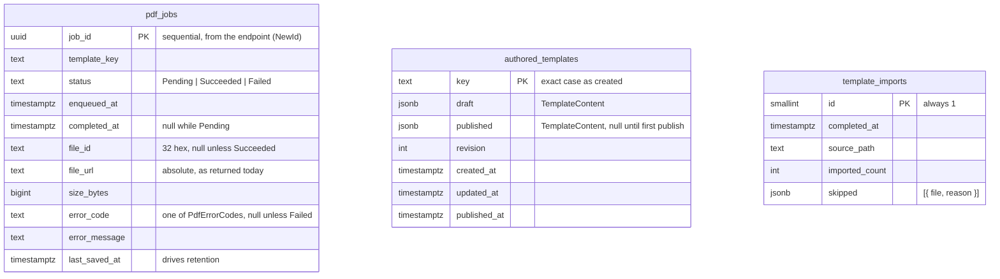

# Data Model: Persistent Storage for Jobs and Authored Templates

One PostgreSQL database for the block, snake_case names. The domain records (`PdfJob`,
`AuthoredTemplate`) are unchanged and never mapped directly: each table has a persistence record in
`PdfBuilder.Infrastructure/Persistence/Records/` that converts to and from the domain record
(`PdfJob` through its existing factory and transitions, `AuthoredTemplate.Restore`).



No relationships: a job stores its `template_key` as text because built-in templates are not in the
database and authored ones may be deleted after a job ran.

Also present, owned by MassTransit's EF Core outbox (R2): `outbox_message`, `outbox_state`,
`inbox_state`. They are configured through MassTransit's model builder extensions and migrated with
the rest of the schema.

## pdf_jobs

| Column | Type | Null | Rule |
| --- | --- | --- | --- |
| `job_id` | `uuid` | no | Primary key. |
| `template_key` | `text` | no | ≤ 64 chars, `PdfRequestLimits.TemplateKeyPattern`. Validated before insert, as today. |
| `status` | `text` | no | Check constraint: `Pending`, `Succeeded`, `Failed` (the `PdfJobStatus` names, as the API returns them). |
| `enqueued_at` | `timestamptz` | no | |
| `completed_at` | `timestamptz` | yes | Set by `Succeed`/`Fail`. |
| `file_id` | `text` | yes | 32 hex characters when set. |
| `file_url` | `text` | yes | Stored as produced, so responses are byte-identical to today. |
| `size_bytes` | `bigint` | yes | |
| `error_code` | `text` | yes | |
| `error_message` | `text` | yes | |
| `last_saved_at` | `timestamptz` | no | Set on every save, from the application clock. |

**Index**: `ix_pdf_jobs_last_saved_at` on `last_saved_at`, for the retention filter and sweeper.

**State transitions** (unchanged, enforced by the domain record):

```
            Enqueued (endpoint, or consumer for bus-only producers)
                 │
                 ▼
             Pending ──Succeed──▶ Succeeded
                 │
                 └────Fail────▶ Failed
```

A transition is a whole-row upsert keyed by `job_id`, exactly the current `IPdfJobStore.SaveAsync`
contract.

**Retention**: a job whose `last_saved_at` is older than `JobStore:RetentionHours` (default 24,
range 1–168) is treated as not found and is deleted by the hourly sweeper.

## authored_templates

| Column | Type | Null | Rule |
| --- | --- | --- | --- |
| `key` | `text` | no | Primary key. `TemplateKey.IsValid`. |
| `draft` | `jsonb` | no | `{ html, css, sampleJson, options }`. |
| `published` | `jsonb` | yes | Same shape. Null means never published (status `Draft`). |
| `revision` | `integer` | no | ≥ 1. Optimistic concurrency token. |
| `created_at` | `timestamptz` | no | |
| `updated_at` | `timestamptz` | no | |
| `published_at` | `timestamptz` | yes | |

**Index**: unique `ux_authored_templates_key_lower` on `key_lower`, a column the server generates as
`lower("key")` (stored, never written by the service), enforcing the existing rule that keys are
unique in any letter case. Lookups by key remain exact-case. A generated column rather than an
expression index, so the rule is part of the EF model and not hand-written SQL in a migration.

**Derived, not stored**: status (`Draft` when `published` is null, `Published` when it equals
`draft`, `Modified` otherwise), computed by the domain record as today.

**Write rules**:

| Operation | Statement shape | Failure mapping |
| --- | --- | --- |
| Add | insert | unique violation → `TemplateKeyTakenException` |
| Update | update where `key` and `revision = expected` | 0 rows: exists → `StaleTemplateRevisionException`; absent → `TemplateNotFoundException` |
| Delete | delete where `key` | 0 rows → `false` |

## template_imports

A single row, written once, in the same transaction as the imported templates.

| Column | Type | Rule |
| --- | --- | --- |
| `id` | `smallint` | Primary key; check `id = 1`. |
| `completed_at` | `timestamptz` | When the import committed. |
| `source_path` | `text` | Resolved `TemplateStore:AuthoredRootPath` at import time. |
| `imported_count` | `integer` | Number of templates inserted. |
| `skipped` | `jsonb` | Array of `{ "file": "...", "reason": "...", "detail": "..." }`, where `detail` is what the reader said and may be null; also logged as warnings. |

**Skip reasons**: `unreadable` (I/O error), `malformed` (not valid template JSON), `invalid-key`,
`built-in-key` (matches a built-in template in any letter case), `duplicate-key` (two files whose
keys differ only in case).

## Configuration surface

See [contracts/configuration.md](contracts/configuration.md).
