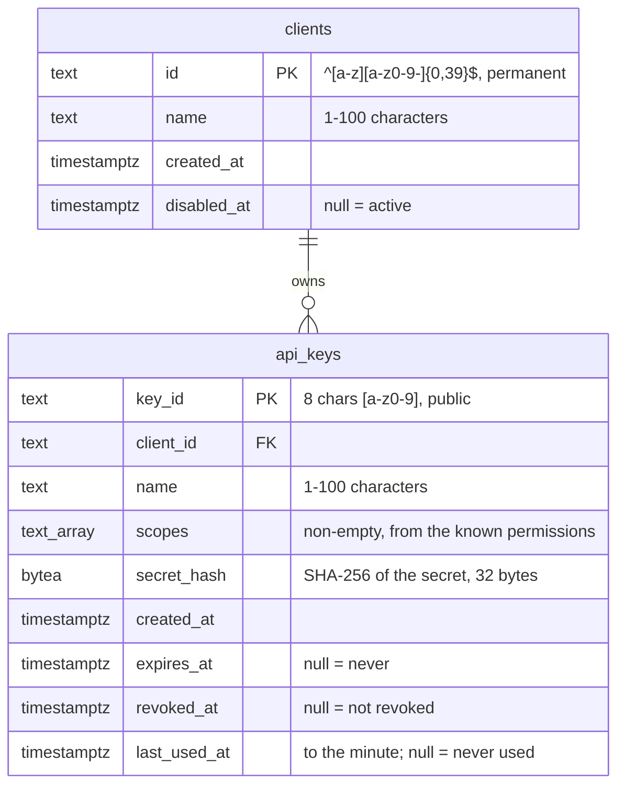

# Data Model: Clients and API Keys

Two tables, defined once in `Blocks.ServiceDefaults.EntityFramework` and added to a block's own
`DbContext` with `modelBuilder.AddBlocksClients()`. For PDF Builder they land in the same database
as `pdf_jobs` and `authored_templates`, through a migration in `PdfBuilder.Infrastructure`. Names are
snake_case, as in 001.



The admin key is not stored here. Configuration holds its hash (`Blocks:Admin:KeyHash`).

## clients

| Column | Type | Null | Rule |
| --- | --- | --- | --- |
| `id` | `varchar(40)` | no | Primary key. Pattern `^[a-z][a-z0-9-]{0,39}$`: lowercase letters, digits and hyphens, starting with a letter, up to 40 characters (spec FR-005). Never changes. |
| `name` | `varchar(100)` | no | Display name, 1–100 characters, trimmed. |
| `created_at` | `timestamptz` | no | |
| `disabled_at` | `timestamptz` | yes | Set when disabled, cleared when enabled again. |

**Check constraint** `ck_clients_id_format`: the id pattern, so a row written outside the service
cannot break the rule.

**State**:

```
          disable                    enable
Active ─────────────► Disabled ─────────────► Active
```

Disabling does not touch keys: a disabled client's keys are refused with `CLIENT_DISABLED` and work
again, unless revoked, when it is enabled.

## api_keys

| Column | Type | Null | Rule |
| --- | --- | --- | --- |
| `key_id` | `char(8)` | no | Primary key. `[a-z0-9]{8}`, random, public; shown in lists and logs. Regenerated if it collides on insert. |
| `client_id` | `varchar(40)` | no | Foreign key to `clients.id`, `ON DELETE RESTRICT` (clients are never deleted). |
| `name` | `varchar(100)` | no | 1–100 characters. Not unique: "production" can be issued again after the old one is revoked. |
| `scopes` | `text[]` | no | Non-empty; each one of `pdf:generate`, `pdf:templates:read`, `pdf:templates:write`. |
| `secret_hash` | `bytea` | no | `SHA-256(secret)`, 32 bytes. The secret itself is never stored. |
| `created_at` | `timestamptz` | no | |
| `expires_at` | `timestamptz` | yes | In the future when set. |
| `revoked_at` | `timestamptz` | yes | Set once, never cleared. |
| `last_used_at` | `timestamptz` | yes | Written at most once a minute per key per instance. |

**Check constraints**: `ck_api_keys_scopes_not_empty` (`cardinality(scopes) > 0`),
`ck_api_keys_secret_hash_length` (`octet_length(secret_hash) = 32`),
`ck_api_keys_key_id_format` (`key_id ~ '^[a-z0-9]{8}$'`).

**Index**: `ix_api_keys_client_id` on `client_id`, for listing a client's keys.

**State**, derived and never stored:

```
          time passes expires_at
Active ───────────────────────────► Expired
  │
  └──── revoke ────────────────────► Revoked      (permanent; Expired keys can be revoked too)
```

`Revoked` wins over `Expired` when both apply. A key is **usable** when it is `Active` and its client
is `Active`.

## The full key

```
pdf_k7f2a9c1_Q8vLx2Tn9WcZr4YpB6sK1dHf7MjG3aE0uVnR5tXo
└┬┘ └──┬───┘ └──────────────────┬───────────────────┘
block  key_id                secret: 40 characters base62, ~238 bits
```

The service never holds the full key after the response that shows it. The display form in lists is
`pdf_k7f2a9c1_…`.

## Permissions

| Permission | Allows | Endpoints |
| --- | --- | --- |
| `pdf:generate` | Submit jobs, read jobs | `POST /api/pdf/jobs`, `GET /api/pdf/jobs/{jobId}` |
| `pdf:templates:read` | List and read templates | `GET /api/templates`, `GET /api/templates/{key}` |
| `pdf:templates:write` | Create, duplicate, edit, publish, delete, preview | every other `/api/templates` endpoint |
| `admin` | Everything, including `/api/admin` | held only by the admin key |

The block code (`pdf`) and the permission list are supplied by the block when it registers the
shared authentication, so the same package serves an email block with `eml` and `email:*`.

## Configuration surface

See [contracts/configuration.md](contracts/configuration.md).
